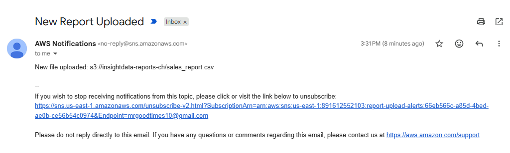

# Serverless Event-Driven
# Data Pipeline: The 
# Missed Report Problem 📈

## 1. Identify the Problem
Client business analysts 
are repeatedly delayed 
in receiving critical 
daily sales files 
uploaded to AWS S3, 
stalling executive 
updates and forcing 
analysts to waste 
manual hours verifying 
deliveries.

## 2. Extract the Why 
## (The Business Impact)
Friction in reporting 
updates causes 
executive stakeholders 
to make critical 
operational decisions 
using inaccurate, 
stale data. This 
introduces strategic 
blind spots, erodes 
consumer trust in the 
analytics pipeline, 
and hazards client 
attrition to more 
reliable platforms—
ultimately impacting 
top-line corporate 
revenue.

## 3. Determine the What 
## (The Technical 
## Grocery List)
* **Storage pad:** 
  Amazon S3 Bucket 
  (InsightData secure 
  reports bucket).
* **Compute core:** 
  AWS Lambda (Python 
  3.12 script trigger).
* **Pager channel:** 
  Amazon SNS Topic 
  (Automated email 
  alert pipeline).
* **Security boundary:** 
  IAM Execution Role.

## 4. Automate/
## Execute the How
* Built a secure, 
  non-public Amazon S3 
  repository bucket 
  blocked from external 
  web exposure.
* Configured an Amazon 
  SNS Topic subscribed 
  to end-user endpoints.
* Authored and deployed 
  a serverless Python 
  3.12 script inside 
  AWS Lambda with an 
  isolated IAM security 
  clearance profile.
* Integrated an S3 
  bucket sensor mapping 
  object create events 
  to execute the Lambda 
  core in real-time.

## 5. Test & Verify 
## (Confirming the 
## Resolution)
* Successfully 
  simulated deliveries 
  by uploading test 
  CSV files to the 
  production container.
* Debugged and optimized 
  critical structural 
  script syntax, loop 
  block alignments, 
  and environment 
  tracking variables.
* Verified execution 
  metrics through live 
  CloudWatch log 
  streams—achieving 
  immediate email 
  alert delivery in 
  under one second.
  
  
  
